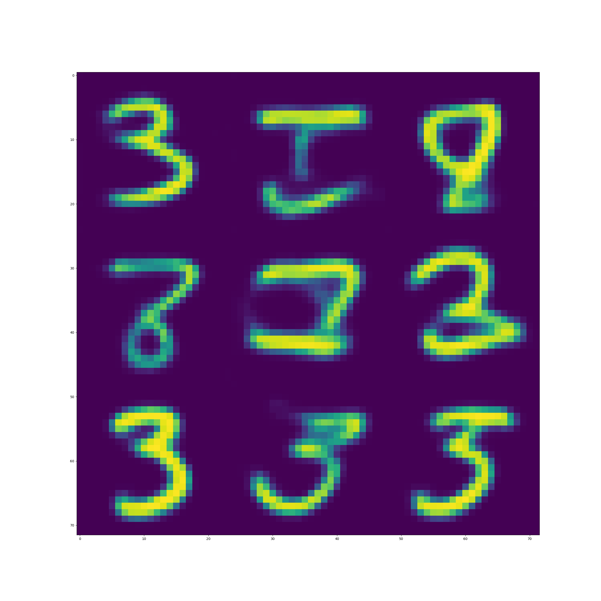
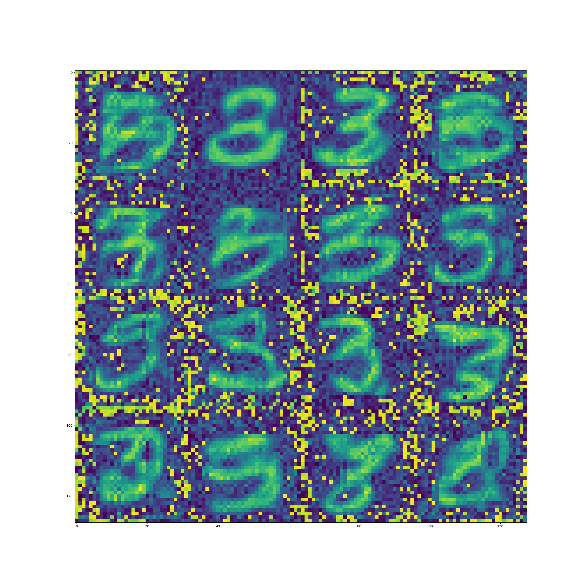

<div align="center">
  <h1>JAX MNIST Generation</h1>
  <p>Two ways to generate a digit: predict its tokens or denoise an image.</p>
</div>

**Draft · consolidation in progress.** This repository brings together two
2022 JAX experiments for generating handwritten digits conditioned on a chosen
number. The original model and training code is preserved; a shared dataset
pipeline and side-by-side demo are the next steps.

| Method | How it works | Current location |
| :-- | :-- | :-- |
| VQ-VAE + GPT | Encode images into discrete tokens, generate tokens conditioned on a digit label, then decode them. | `models/`, `trainers/`, `utils/`, `main.py` |
| Classifier-guided diffusion | Train a noise predictor and a classifier, then use classifier gradients to guide iterative denoising. | `guided_diffusion/` |

## Setup

Install [uv](https://docs.astral.sh/uv/getting-started/installation/), then:

```sh
uv sync --locked
```

Python 3.12 is selected by `.python-version`. Dependencies are declared in
`pyproject.toml` and resolved in the committed `uv.lock`; development tools are
included by default. Haiku is retained for the existing models, and Flax is
currently used for training-state dataclasses. A model migration is deferred.

**Setup installs the environment; the legacy entry points are not yet runnable
from a fresh clone.** Both import `datasets.preprocess.get_dataset`, whose source
was excluded from the original repositories. Their default modes also load
checkpoints that are not included. No training or generation command is
advertised until those paths are restored and checked.

## Existing samples

These are historical outputs, preserved from the original repositories. They
have not been regenerated or evaluated under the new dependency lock.

| VQ-VAE + GPT | Guided diffusion |
| :--: | :--: |
|  |  |

More samples are in `generated_digits/` and
`guided_diffusion/generated_digits/`. Denoising animations are preserved in
`guided_diffusion/generated_digits_process/`.

## Next steps

- Restore shared MNIST loading, with appropriate normalization for each method.
- Correct and verify token sampling, timestep conditioning, and diffusion sampling.
- Provide small training and generation commands with fixed seeds.
- Generate a side-by-side demo using the same requested digits and sample counts.
- Add shared evaluation, while keeping the method-specific training steps simple.

## Development

```sh
uv run ruff check --select E9,F63,F7,F82 .
uv run python -m compileall -q main.py models trainers utils guided_diffusion
```

CI checks dependency imports, Python syntax, and critical lint errors without
running training. Ruff formatting/import sorting and standard Pyright settings
are configured for the upcoming cleanup; the untouched legacy scripts do not
yet pass the full formatting and type checks.

Downloaded datasets belong in `data/`; model weights belong in `weights/`.
Dataset-loader Python source should be committed. Existing scripts still use
their original paths and will be updated during the code cleanup.

## Origin and license

The VQ-VAE/GPT code comes from `enri8421/generate_minst` at
`a40bc2598935bd4196718f268fc07388edfefe1b`. The diffusion code and samples were
copied from `enri8421/guided_diffusion` at
`54dfca8dad571bfcde8023945048fa8acbcf1f10`, without changing their contents.

[MIT License](LICENSE) · Enrico Bianchi.
