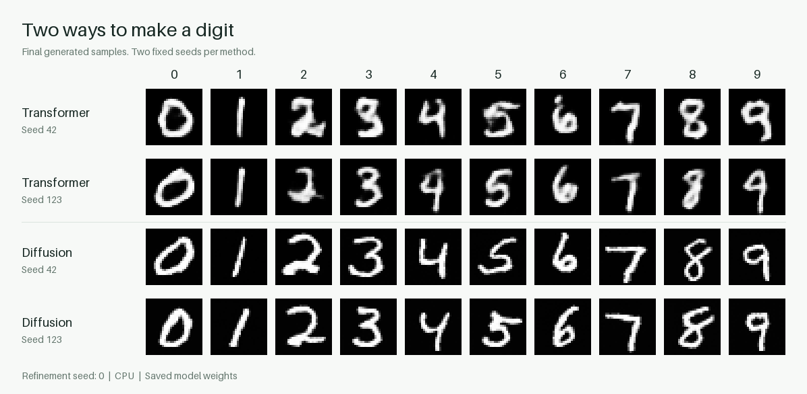

<div align="center">
  <h1>JAX MNIST Generation</h1>
  <h3>One digit. Two generative paths.</h3>
  <p>Build it from discrete codes. Or bring it out of noise.</p>
  <p>
    
    
    
    <a href="LICENSE"></a>
  </p>
  <p><a href="https://jax-mnist-generation.streamlit.app">Live demo</a> · <a href="#try-it">Run locally</a> · <a href="#two-ways-to-build-a-digit">How it works</a> · <a href="#reproduce-it">Reproduce it</a></p>
</div>

[](https://jax-mnist-generation.streamlit.app)

A small, fully reproducible experiment in generating handwritten digits.
Choose a number, explore different variations, and watch two very different
methods arrive at the same idea.

The grid above comes straight from the saved models: **every digit, two fixed
seeds per method, no handpicked samples**.

## Two ways to build a digit

| | Residual VQ + Transformer | Conditional diffusion |
| :-- | :-- | :-- |
| **Start with** | A rough arrangement of learned codes | Random noise |
| **Build the image** | Predict finer details across three scales | Remove noise over 200 steps |
| **Watch it emerge** | 1 × 1 → 3 × 3 → 7 × 7 code grids | 0 → 140 → 200 denoising steps |

The first path builds a digit from coarse to fine. A tokenizer learns a compact
visual vocabulary; a transformer predicts which codes belong together.

The second path learns to turn noise into the chosen digit, one denoising step
at a time. Both are compact models written in **JAX and Flax NNX**, trained on MNIST.

## Try it

**[Open the interactive demo](https://jax-mnist-generation.streamlit.app)** — choose a digit and explore.

Or run it locally:

**The trained weights are included. No training needed.**

Install [uv](https://docs.astral.sh/uv/getting-started/installation/), then run:

```sh
uv run --locked streamlit run app.py
```

Open **http://localhost:8501** and play:

- **Choose a digit** to see both methods generate it.
- **Regenerate both** to explore a new variation.
- **Refine again** to keep the first two stages and resample the final one.
- **Set the seeds** to revisit a result.

The app shows all six stages side by side. Its interface is written entirely in
Python with Streamlit. The first generation includes compilation; later ones
reuse the compiled models.

## Reproduce it

One command downloads MNIST, trains all three models, and rebuilds the grid above:

```sh
sh scripts/reproduce.sh
```

On Apple Silicon, use `METAL=1 sh scripts/reproduce.sh` to train with the optional
Metal backend. Grid generation always runs on CPU.

The preview is generated by [a small Python script](scripts/preview.py), using
main seeds **42** and **123** and refinement seed **0**. You can regenerate it
from the saved weights without retraining.

Training settings, individual commands, project layout and deployment notes are
in the [development guide](docs/development.md). Seeds and locked dependencies
make experiments repeatable on the same backend; CPU and Metal results can differ.

## Ideas behind it

- [Next-Concept Modeling](https://arxiv.org/abs/2610.14162) inspired the coarse-to-fine
  hierarchy. This is a small image adaptation, not a reproduction of the paper.
- [CoordConv](https://arxiv.org/abs/1807.03247) gives the decoder a sense of position.
- [Classifier-free guidance](https://arxiv.org/abs/2207.12598) steers diffusion toward
  the chosen digit, using [v-prediction](https://arxiv.org/abs/2202.00512).

## License and data

Code: [MIT](LICENSE) · Enrico Bianchi. Model weights and sample images: see the
[asset licensing notes](docs/data-and-licenses.md#model-weights-and-images).

MNIST is credited to Yann LeCun, Corinna Cortes and Christopher J. C. Burges.
Its dataset terms are separate from the code license; see the
[data and license notes](docs/data-and-licenses.md).
